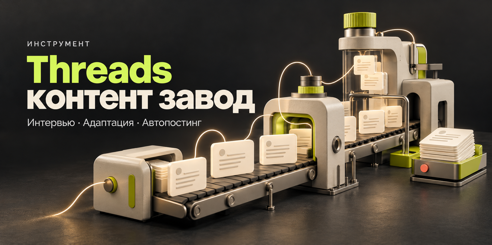

<p align="center"></p>

# Threads контент завод

**Расскажи о своей нише. Получи посты по сильным референсам. Настрой публикации из чата.**

[Начать с AI-ассистентом](START.md) · [Скачать комплект](https://github.com/C0mrade530/threads-content-factory/releases/latest) · [Подключить ChatGPT / Claude](docs/CONNECT_CHAT.md) · [Развёртывание](docs/DEPLOY.md)

Инструмент для личного бренда и бизнеса: сначала интервью, затем оригинальные тексты по твоей нише, подключение твоего Threads и согласованное расписание. Можно сказать ассистенту: **«Два поста в день, в 10:00 и 18:00 по Москве»** — он изменит настройки через инструменты сервиса.

<table><tr><td><b>351</b><br>скриншот-пример</td><td><b>318</b><br>подсказок адаптации</td><td><b>64</b><br>авторские подборки</td><td><b>2 режима</b><br>утверждённые тексты / автопилот</td></tr></table>

## Как это выглядит

```text
Ты: «Хочу вести Threads для студии дизайна»
Ассистент: интервью о нише, аудитории, голосе и фактах
Ассистент: пять разных постов по подходящим примерам
Ты: «Подключаем аккаунт» → ссылка входа → подтверждение @имени
Ты: «Три поста в день, часовой пояс Москва»
Ассистент: показывает часы и режим, получает согласование
Сервис: сохраняет очередь и отправляет посты по расписанию
Ты: «Покажи очередь» / «Два в день» / «Поставь на паузу»
```

### Два способа пользоваться

| | Посты в чате | Полный цикл |
|---|---|---|
| Интервью и адаптация | Да | Да |
| Ключ генерации на сервере | Не нужен | Для фоновой генерации |
| Подключение Threads | Не требуется | Через Upload-Post |
| Публикация по времени | Вручную | Постоянный worker |
| Управление словами | Инструкция | MCP или GPT Actions |

**Ссылка на GitHub сама по себе не подключает аккаунт и не запускает вечный процесс внутри чата.** Для полного цикла один раз поднимается сервис; дальше им можно управлять из Claude Desktop/Codex через MCP или личного GPT через Actions. Каждый пользователь использует свой экземпляр и свои ключи.

## Попробовать прямо сейчас

Отправь ассистенту ссылку на репозиторий и текст из [START.md](START.md). Если он не читает GitHub, скачай ZIP через **Code → Download ZIP**, распакуй и приложи:

1. [`AGENT.md`](AGENT.md) — сценарий интервью и управления.
2. [`reference/БАЗА_ДЛЯ_AI.md`](reference/БАЗА_ДЛЯ_AI.md) — пояснения и распознанные примеры.

Для просмотра всей коллекции скачай комплект из [Releases](https://github.com/C0mrade530/threads-content-factory/releases/latest) и открой `КАТАЛОГ.html`. Изображения сохранены в `reference/photos/`; OCR не заменяет оригиналы.

## Запустить автопостинг

Нужны Python 3.11+, [uv](https://docs.astral.sh/uv/), свой API key [Upload-Post](https://www.upload-post.com/). Его тарифы и квоты действуют отдельно. Для автономного создания новых текстов также нужны свой ключ OpenAI Responses API и выбранная модель; можно начать с текстов, которые написал и утвердил в чате.

Постоянный worker запускается на macOS/Linux; в Windows используй WSL2 или Docker Compose.

```bash
git clone https://github.com/C0mrade530/threads-content-factory.git
cd threads-content-factory
uv sync --extra mcp
uv run threads-factory init
```

Команда спросит ключи **локально** и сохранит `.env` с правами `600`. Затем запусти API и worker в двух терминалах:

```bash
uv run threads-factory serve
uv run threads-factory worker
```

Или используй постоянный сервер:

```bash
docker compose up -d --build
```

Дальше подключи инструменты по [пошаговой инструкции](docs/CONNECT_CHAT.md), начни интервью и выбери частоту. ChatGPT Actions требует доступного HTTPS-адреса сервиса; локальный MCP работает через stdio. Сервис должен оставаться включённым.

### Что можно настроить из чата

- Нишу, аудиторию, темы, голос, факты, ограничения и точный CTA.
- От 1 до 24 постов в день, часовой пояс и конкретные часы.
- Утверждённую подборку или будущую автоматическую генерацию.
- Проверку аккаунта и очереди, изменение плана, паузу.

Расписание по умолчанию **выключено**. Автопилот включается только после отдельного согласования аккаунта, частоты и режима. Замена профиля или расписания отменяет ещё не отправленные слоты, сохраняя тексты в истории.

## Что внутри

```text
AGENT.md                 инструкция для AI-ассистента
START.md                 короткий стартовый запрос
reference/               351 скриншот, пояснения, OCR, каталог
threads_factory/         API, SQLite-очередь, генератор, worker, MCP
docs/openapi.json        схема для GPT Actions
compose.yaml             постоянный API + worker с общим volume
tests/                   проверки сценариев и контрактов
```

## Отправка и восстановление

Тексты проходят через сохранённый профиль и проверку заимствований. Worker сверяет реальный идентификатор Threads перед отправкой. У каждой публикации есть стабильный request_id и Idempotency-Key.

При неизвестном исходе отправки сервер проверяет статус чтением и **не повторяет POST**. После перезапуска незавершённые отправки сохраняются как unknown. Статус published требует успешного результата именно Threads и ссылки на пост. Уже начатая отправка может завершиться после паузы. Подробности — [в описании состояний](docs/DEPLOY.md).

## Проверки и готовность

```bash
uv sync --extra test --extra mcp
uv run pytest -q
```

Реализованы API, MCP-мост, профиль, подключение через провайдера, расписание, генерация и очередь. Локальные тесты проверяют полный цикл с подменёнными внешними API, защиту от дублей, паузу, смену аккаунта, DST, согласование и контракты запросов. Ключи и чужие подключённые аккаунты не входят в репозиторий. Живую авторизацию и первую публикацию каждый владелец проверяет на своём экземпляре.

**Код — MIT.** Исходные примеры остаются материалами своих авторов; обещаний охватов нет. [Происхождение материалов и первичная документация](docs/SOURCES.md).
